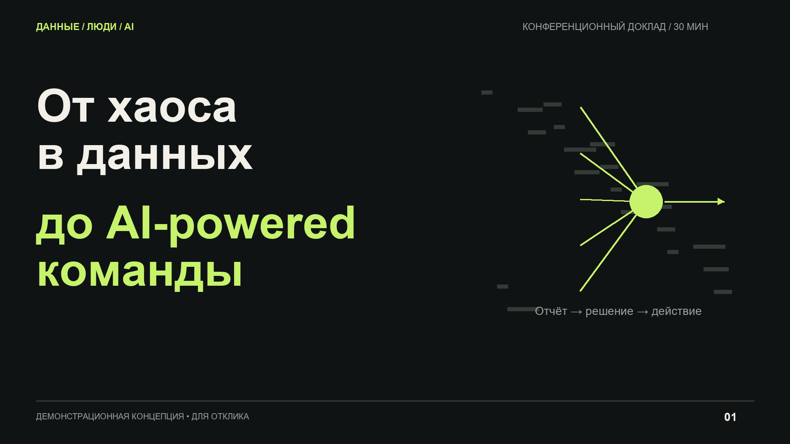
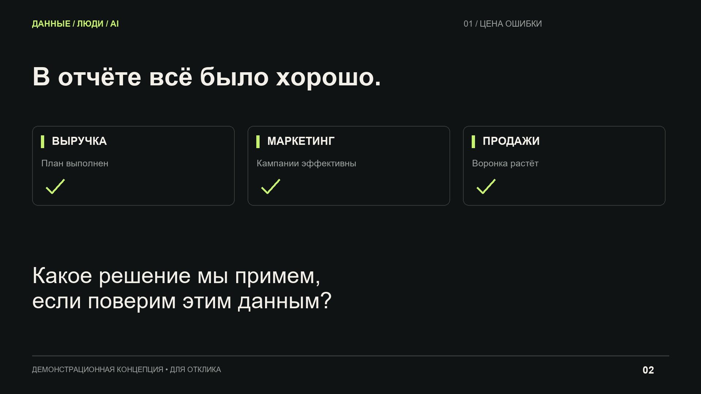
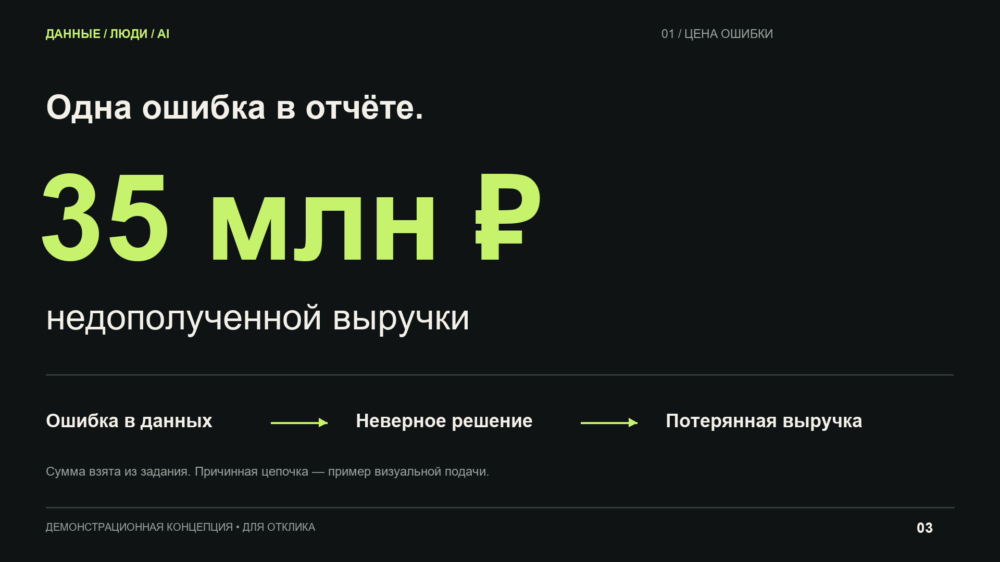
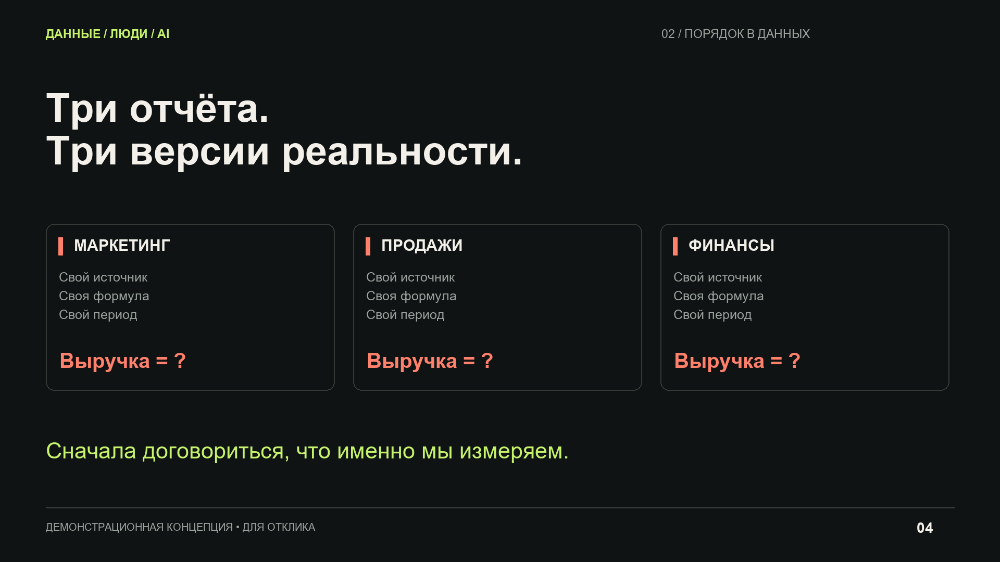
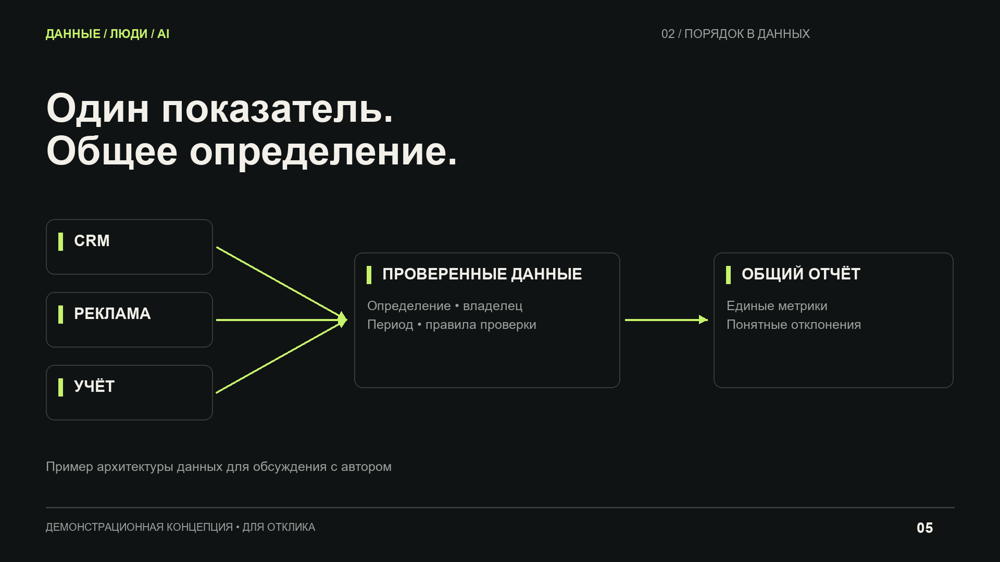
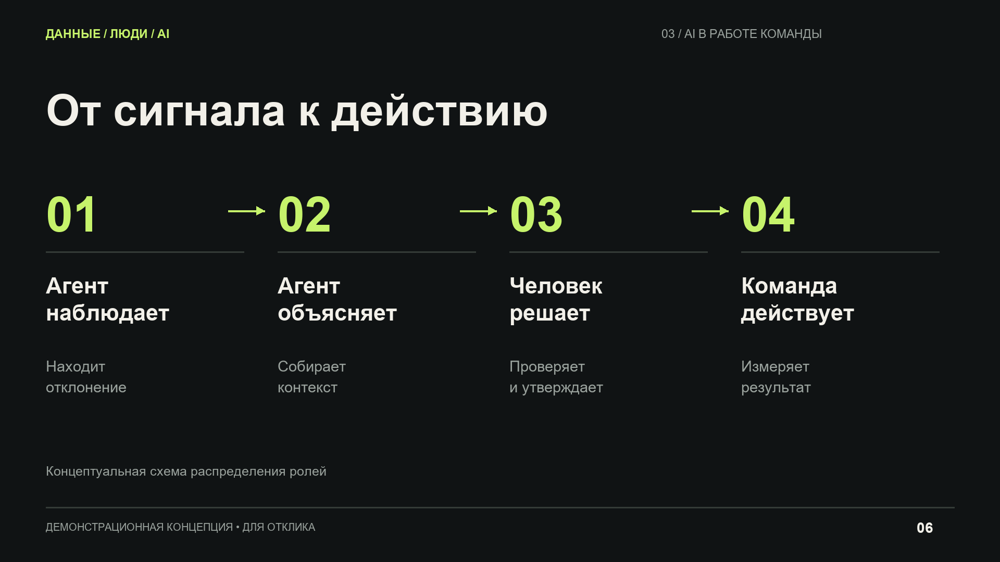
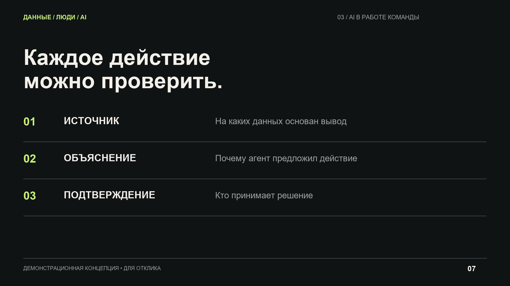
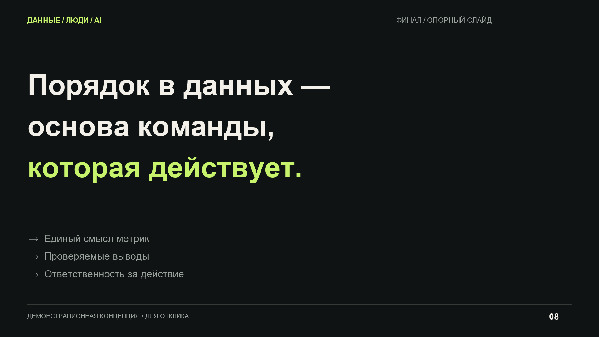

# От хаоса в данных до AI-powered команды

Демонстрационная визуальная концепция для отклика на задачу дизайна конференционного доклада.

8 слайдов PNG 1920×1080 и 9-секундный ролик MP4. Общий размер около 0,73 МБ.

Это концепт, созданный под описание задания. Кит конференции и полный текст доклада не использовались. Сумма 35 млн ₽ взята из задания, схемы служат примерами визуальной подачи.

## Просмотр

[Смотреть пример переходов](portfolio-ai-team/09-reveal.mp4)

[Скачать весь комплект ZIP](portfolio-ai-team.zip)
